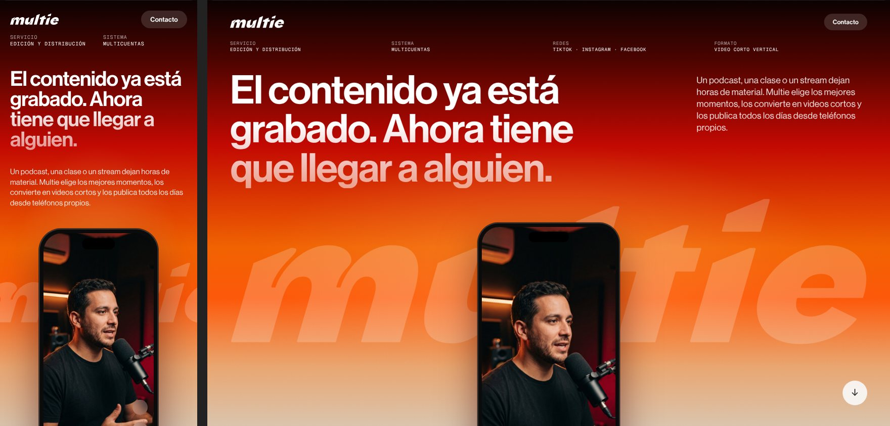
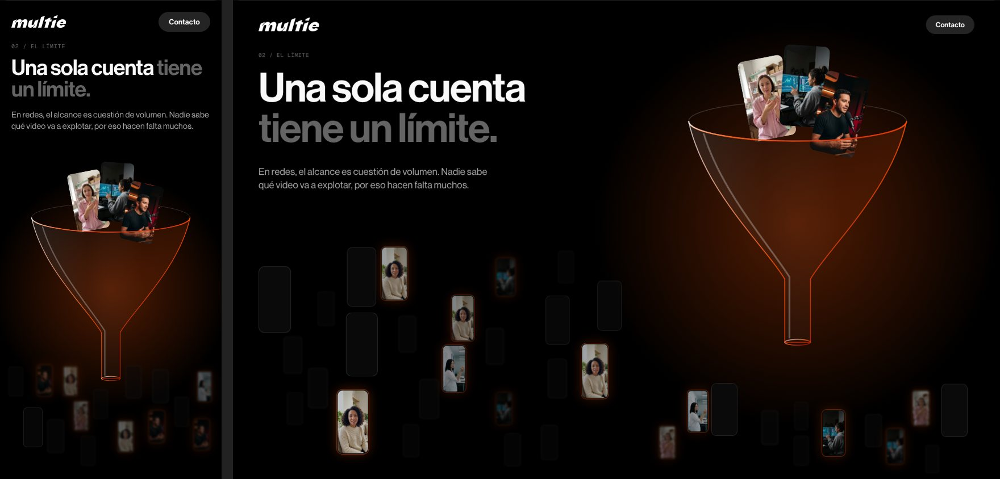
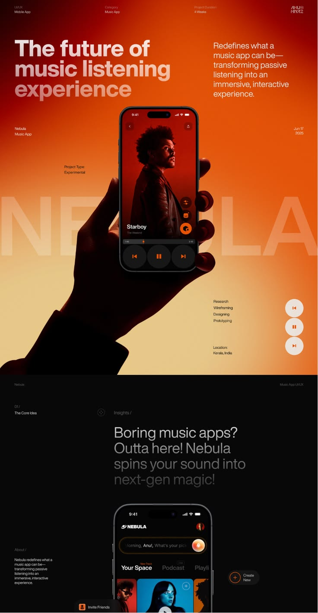

# Multie — biblia de la landing

17 de noviembre de 2026 · actualizada el 20 de noviembre · Cotu

Todo lo necesario para construir la landing de Multie: qué es, qué dice, cómo se mueve, cómo se ve, con qué assets y cómo trabajamos. Lo que no esté acá se consulta con Cotu antes de decidirlo.

## Contexto y reglas

Multie convierte videos largos en piezas cortas y las publica todos los días desde muchas cuentas a la vez, manejadas desde teléfonos reales. Es un producto de Funke. La landing tiene un solo objetivo: que el visitante pida una propuesta por mail o por WhatsApp.

- **Para quién:** marcas personales y creadores con mucho material grabado (podcasts, clases, streams). Mercados: Argentina, el resto de Latinoamérica y España.
- **Tono:** serio, premium, directo y un poco provocador.
- **Palabra clave:** "multicuentas", alternada con "teléfonos propios" o "teléfonos reales".
- **Nunca:** "granja" ni precios. Bots y garantías se tocan solo en las preguntas frecuentes, con las respuestas aprobadas.
- **Clientes:** no se nombra a ninguno sin permiso.
- **Los teléfonos reales:** no se muestran filmados. Se representan con diseño y 3D.
- **Marca:** el manual de Funke es referencia, no regla. Multie tiene logo propio y Funke aparece solo como firma: "un producto de funke".

## Guion

Textos aprobados por Cotu. Van tal cual: si alguno no entra en el diseño, se consulta antes de cambiarlo.

**1 · Apertura**

- Etiqueta: multie · edición y distribución con multicuentas
- Titular: **El contenido ya está grabado. Ahora tiene que llegar a alguien.**
- Texto: Grabar ya no es el problema: hoy alcanza con un teléfono. El problema es que lo consuma alguien. Multie produce y publica tu contenido todos los días desde decenas de cuentas a la vez, en teléfonos propios. No es clipping: es un sistema de teléfonos trabajando para tu marca.
- Remate: **Pasanos el archivo. Del resto nos encargamos nosotros.**

**2 · Embudo**

- Titular: **Una sola cuenta tiene un límite.**
- Texto: En redes, el alcance es cuestión de volumen. Nadie sabe qué video va a explotar, por eso hacen falta muchos. Imaginá cientos de cuentas publicando tu contenido todos los días.
- Etiqueta: multicuentas
- Titular: **Un sistema de teléfonos publicando a la vez.**
- Texto: Multie trabaja con un ecosistema de teléfonos reales. Cada teléfono maneja sus propias cuentas, con su propia conexión, y cada cuenta publica todos los días. Un solo video largo sale convertido en decenas de piezas, por decenas de cuentas a la vez. Y cada una puede publicar para el país que elijas: Argentina, México, España o donde esté tu público.

**3 · El proceso**

- 01 **Se envía el material.** Un archivo o un link de YouTube. Sirve lo que se graba esta semana y también el archivo viejo que nunca se usó.
- 02 **Elegimos y editamos.** Buscamos los momentos que se sostienen solos y los armamos en vertical, con subtítulos y con el estilo que el cliente elige en la plataforma.
- 03 **Repartimos los videos.** Los videos se distribuyen entre las cuentas según la estrategia del proyecto: qué publica cada una, en qué horario y con qué frecuencia.
- 04 **Se publica y se mide.** Las cuentas publican todos los días. En la plataforma se ve en vivo qué video funciona y por qué.

**4 · La escala**

- Etiqueta: la escala
- Titular: **Un plan a tu medida.**
- Contador: 5 · 10 · 50 · 100 cuentas
- Texto: Cuentas en TikTok, Instagram y Facebook, para llegar a cada público en la red donde está.

**5 · Cierre**

- Pregunta: **¿Tenés material que no estás aprovechando?**
- Texto: Con una charla alcanza para verlo y armar un plan.
- Campo de mail con el botón **Pedir una propuesta** y el botón **Hablar por WhatsApp**
- Firma: un producto de funke

**La diferencia** (va entre el embudo y el proceso)

- Etiqueta: la diferencia
- Titular: **Cuentas exclusivas para tu marca.**
- Línea: Más alcance que un anuncio. Más control que el clipping.
- Tabla comparativa (textos exactos):

| | una sola cuenta | anuncios pagos | agencias de clipping | multie |
| --- | --- | --- | --- | --- |
| dónde se publica | En tu cuenta | En tu cuenta, como anuncio | En cuentas de terceros | En decenas de cuentas solo tuyas |
| quién lo publica | Vos, cuando podés | La plataforma, mientras pagás | Cada creador, a su manera | Personas, desde teléfonos reales |
| cuánto se publica | Uno o dos videos por día | Lo que pagues | Mucho, sin control | Decenas de videos, todos los días |
| para qué público | El que ya te sigue | El que segmentes | El de cada creador | El del país que elijas |
| qué queda | Una cuenta | Nada, cuando dejás de pagar | Videos en cuentas ajenas | Cuentas y audiencia de tu marca |

El trato queda como está en cada texto (voseo en la mayoría, "tu medida" en la escala). Es una decisión de Cotu: no se unifica. En la página nunca se nombra cómo se llega a otros países (nada de proxys ni términos técnicos): solo el beneficio, "el país que elijas".

## Cómo funcionan todas las escenas

Cada escena queda fija en pantalla mientras se scrollea, y el scroll hace avanzar lo que pasa adentro. No hay botones ni clics: la historia la maneja el dedo.

- **Duración:** cada escena dura una cantidad de pantallas de scroll. Acá los momentos se marcan en porcentaje de esa duración: 0 % es cuando la escena llega y 100 % cuando se va.
- **Con inercia:** el scroll tiene inercia con Lenis (`lerp: 0.09`), conectado a GSAP y ScrollTrigger. Es clave para Cotu. No hay barras de progreso ni contadores de avance.
- **Textos:** aparecen y desaparecen con un fundido corto en el momento que marca cada escena. Nunca hay dos textos encima.
- **Compu primero (por ahora):** se cierra la versión de 1440 px y después se revisa celular (390 px). Ningún objeto tapa un texto, y nunca se ven a la vez los textos de dos secciones.
- **Teléfonos:** todos salen de un único componente (marco, interfaz de TikTok o de Instagram, contador de vistas) que entregan Cotu y Claude en `componentes/telefono/`. Las redes se alternan: TikTok, Instagram, TikTok… Debajo de 120 px de ancho van en modo "solo" (marco y video). Desperdigados en la apertura y la escala; en grilla en el embudo. Sin halo ni desenfoque.
- **Fondo:** la apertura arranca en el degradado cálido, pasa a negro plano, sin estrellas, y el cierre vuelve al degradado.
- **Encabezado fijo:** logo de Multie a la izquierda y botón Contacto a la derecha, que lleva al cierre. Se oculta en la escena de cierre.

**Orden de la página:** apertura, embudo, la diferencia, proceso, escala, para todos los nichos, cómo se trabaja, la plataforma, preguntas frecuentes, cierre y footer.

En total son unas 20 pantallas de scroll. Si al probarlo en el celular se siente largo, se acortan los tramos sin cambiar el orden.

## Escena 1 — Apertura

Un teléfono en 3D sobre el degradado cálido muestra un video y, al bajar, resulta ser uno entre cientos. Dura 3,2 pantallas. Textos: guion, punto 1.

**Lo que se ve al llegar**

- Fondo con el degradado cálido y grano suave. Encabezado con el logo en blanco y el botón Contacto de vidrio.
- Arriba: la etiqueta "multie · edición y distribución con multicuentas" (los cuatro datos editoriales se sacaron), el titular grande a la izquierda y el párrafo (a la derecha en compu, debajo en celular). Detrás del teléfono, "multie" gigante y semitransparente.
- Abajo: el teléfono protagonista, negro y metálico, girado casi de costado. En la pantalla corre un video de un creador hablando a cámara.
- En compu, un botón redondo con una flecha para bajar.

**Al scrollear**

- **0 a 100 %:** el teléfono gira hasta quedar de frente y la cámara se aleja de a poco. Su pantalla se apaga un poco: deja de ser el protagonista y pasa a ser uno más.
- **18 a 68 %:** detrás aparecen muchos teléfonos apagados, desperdigados sin patrón y a distintas distancias.
- **0 a 50 %:** se ve el primer texto. Después se va.
- **56 a 100 %:** aparece el remate "Pasanos el archivo. Del resto nos encargamos nosotros.", grande y abajo al centro.
- **70 a 100 %:** el fondo pasa del degradado al negro.
- **Al terminar:** el remate se va del todo antes de que aparezca el primer texto del embudo.

**Celular y compu**

- En celular el teléfono va más abajo para no tapar el texto.
- En compu los teléfonos de fondo se reparten en todo el ancho.

## Escena 2 — Embudo

Un solo teléfono, el del creador, no da abasto: se le acumula una cola de videos. Después queda como origen de una red: de él salen líneas a una grilla de 24 teléfonos y cada video viaja por su línea y enciende uno. La escena fija dura 340 vh. Textos: guion, punto 2. Referencia: `referencias/boceto-embudo-proceso/` (y https://claude.ai/artifact/KxMnKCLeT3K2bihrCHQQnN).

**Lo que se ve al llegar (compu)**

- Fondo negro. Texto a la izquierda: etiqueta "el límite", "Una sola cuenta tiene un límite." y su texto.
- A la derecha del texto, el teléfono del creador (unos 230 px de ancho), con interfaz de TikTok y las vistas clavadas en "1.240 vistas".

**Al scrollear**

- **4 a 40 %:** entran videos verticales desde la derecha, de a uno, y se apilan al lado del teléfono. Nunca pisan el texto.
- **45 %:** cambia el texto: etiqueta "multicuentas", "Un sistema de teléfonos publicando a la vez." y su texto.
- **46 a 58 %:** el teléfono del creador se achica (unos 112 px) y se corre a su lugar de origen, a la izquierda de la grilla. La cola se junta detrás.
- **56 a 72 %:** se dibujan líneas finas desde el teléfono del creador a cada teléfono de una grilla ordenada de 6 × 4, que aparecen apagados en la mitad derecha.
- **62 a 97 %:** cada video viaja por su línea, la pinta de naranja y enciende su teléfono, en orden salteado. Cada teléfono encendido arranca su contador de vistas.
- **Etiquetas de país:** ocho teléfonos de la grilla muestran al encenderse el código de su país (AR, MX, ES, CO, CL, US, PE, UY). Medidas y posiciones exactas en `feedback/2026-11-20-version-3.md`, punto 5.2.

## Escena 3 — El proceso

Una sola escena fija, sin scroll horizontal: el episodio largo se ve como en un editor, se eligen sus mejores momentos, se recortan en vertical desde el mismo cuadro y bajan a los teléfonos. Todo sale de `assets/proceso/episodio.mp4`. Dura 340 vh. Textos: guion, punto 3. Referencia: `referencias/boceto-embudo-proceso/`.

**Lo que se ve siempre**

- Fondo negro. Etiqueta "el proceso" arriba a la izquierda.
- Abajo, los cuatro pasos del guion en fila: número, título y texto. El activo en blanco, los demás atenuados. Cambia al 25, 50 y 75 %.

**Al scrollear**

- **0 a 25 % · 01:** arriba del editor, "episodio_completo.mp4" se sube (barra naranja) y aparece "2,4 GB · 01:24:36". Aparecen el video, la tira de cuadros y la forma de onda del audio. Al costado, la transcripción.
- **25 a 50 % · 02:** un cabezal recorre el episodio con el contador de tiempo. Al pasar por cada buen momento lo marca en naranja en la onda y resalta su frase en la transcripción. Un recuadro 9:16 encuadra a quien habla.
- **50 a 75 % · 03:** el editor se achica y sube. Del cuadro salen cuatro recortes verticales del mismo video; antes de llegar se les suman subtítulos y un zoom; bajan a una fila de cuatro teléfonos.
- **75 a 100 % · 04:** los cuatro teléfonos publican, con su cuenta y las vistas subiendo.

La transcripción y los subtítulos son los que escribió Agustín y están aprobados.

## Escena 4 — La escala

Los teléfonos crecen de 5 a 100 mientras un contador grande marca la cantidad de cuentas. Dura 4,6 pantallas. Textos: guion, punto 4.

**Lo que se ve**

- Fondo negro.
- Arriba: la etiqueta "la escala", el titular "Un plan a tu medida." y la línea de las redes.
- Al centro, teléfonos encendidos, sin ocupar toda la pantalla. Abajo, el contador con la palabra "cuentas".

**Al scrollear**

- **0 a 25 %:** 5 cuentas.
- **25 a 50 %:** 10 cuentas.
- **50 a 75 %:** 50 cuentas.
- **75 a 100 %:** 100 cuentas.
- Cada cambio se anima: aparecen más teléfonos.

**Los teléfonos:** no ocupan toda la pantalla. Hay dos caminos para probar: una grilla simétrica más chica, o teléfonos dispersos sin patrón. La cantidad en pantalla no tiene que ser literal: el número lo dice el contador.

**Redes:** se publica en TikTok, Instagram y Facebook.

**Ritmo:** el número y sus teléfonos aparecen siempre juntos (nunca el número solo). Al final, el "100 cuentas" se va antes de que entre "Para todos los nichos".

## Zona de abajo

Va entre la escala y el cierre. Es scroll normal, sin escenas fijas: acá se lee. Fondo negro. Son cuatro bloques, en este orden. "La diferencia" ya no está acá: subió entre el embudo y el proceso. Referencia de todos: `referencias/boceto-zona-de-abajo/` (y https://claude.ai/artifact/PYiwhAADmdditj8dnvDbqQ). Medidas exactas en `feedback/2026-11-20-version-3.md`.

**A · Para todos los nichos**

- Etiqueta: para quién
- Titular: **Para todos los nichos.**
- Texto: Para quien ya graba y tiene algo para decir. Elegí el tuyo.
- **Cómo se ve:** a la izquierda, los diez nichos en una lista de texto grande (el activo en naranja, el resto en gris oscuro). A la derecha, un solo teléfono grande con el clip del nicho, su cuenta y las vistas subiendo; debajo, la línea del nicho. La lista avanza sola cada 3,8 s; pasar el mouse la detiene y activa un nicho; un clic lo deja fijo. No hay selector de redes: los nichos alternan TikTok e Instagram.
- **Líneas por nicho:**
  - Trading: Tu lectura del mercado, en el feed de traders que todavía no te siguen.
  - Inversiones: Las ideas que hoy explicás a pocos, frente a gente nueva todos los días.
  - Finanzas personales: El consejo que le ordena el mes a alguien, justo en su feed.
  - Cripto: La novedad del día, publicada mientras todavía es noticia.
  - Negocios: Una charla de una hora, partida en decenas de aprendizajes cortos.
  - Real estate: Tus propiedades y tu criterio, a la vista de compradores nuevos.
  - Ecommerce: Tu producto, frente a públicos que todavía no lo conocen.
  - Coaching: Tus ideas, contadas de muchas formas y en muchas cuentas.
  - Desarrollo personal: Esa reflexión que funciona, llegando a quien todavía no te escuchó.
  - Podcasts: El episodio entero, cortado en los momentos que más enganchan.
- Usuario y descripción del video de cada nicho: tabla del punto 9 de `feedback/2026-11-20-version-3.md`.
- **Clips:** hasta tener los reales del equipo, este cruce: Trading → `cortos/01-trading`; Inversiones → `cortos/02-finanzas-b`; Finanzas personales → `cortos/02-finanzas`; Cripto → `cortos/01-trading-b`; Negocios → `cortos/05-calle-b`; Real estate → `cortos/03-real-estate`; Ecommerce → `cortos/04-ecommerce`; Coaching → `cortos/06-clase`; Desarrollo personal → `cortos/06-clase-b`; Podcasts → `apertura/creador`.
- Abajo: ¿Es un negocio sin cara visible? También funciona para tiendas online, inmobiliarias y academias. · ¿No está tu nicho? Escribinos → (abre WhatsApp).

**B · Cómo se trabaja**

- Dos columnas: a la izquierda el titular, fijo mientras se scrollea; a la derecha dos tarjetas.
- Etiqueta: cómo se trabaja
- Titular: **Dos formas de trabajar.**
- Texto: Las dos están incluidas. Se elige según cuánto apoyo necesite el proyecto.
- **Con el contenido resuelto.** Ya sabés qué querés decir. Nos mandás el material, lo editamos y lo publicamos desde las cuentas. Etiquetas: Edición · Subtítulos · Publicación en multicuentas · Métricas.
- **Con estrategia.** Arrancamos por el análisis del proyecto. Definimos qué temas se cuentan, cómo se habla y qué se muestra. Después editamos y publicamos siguiendo ese plan. Etiquetas: Análisis del proyecto · Plan de temas · Edición · Publicación en multicuentas · Métricas.

**C · La plataforma**

- Titular y texto centrados; debajo, la maqueta de Agustín centrada y ancha (hasta 1200 px), con la etiqueta "ejemplo ilustrativo".
- Etiqueta: la plataforma
- Titular: **Visibilidad de verdad.**
- Texto: Todo lo que se publica se ve en un solo lugar: qué cuenta lo publicó, cuándo y cómo rindió.

**D · Preguntas frecuentes**

- Etiqueta: preguntas frecuentes
- Titular: **Antes de hablar.**
- Dos columnas, como "Cómo se trabaja": a la izquierda el titular fijo, la línea "¿No está tu pregunta? Escribinos y lo vemos." y el botón **Hablar por WhatsApp**; a la derecha las preguntas.
- Agrupadas en cuatro temas. Se abren de a una, como un acordeón. La primera arranca abierta.

*El servicio*

- **¿Qué hace Multie?** Convertimos tu material en videos cortos y los publicamos todos los días desde muchas cuentas a la vez, en TikTok, Instagram y Facebook.
- **¿En qué se diferencia de una agencia?** Una agencia maneja tus cuentas. Multie publica tu contenido en muchas cuentas al mismo tiempo: son tuyas y las manejamos nosotros. Y a diferencia de las agencias de clipping, esas cuentas no son de terceros que cobran por vista.
- **¿Usan bots?** No. Cada video se sube desde un teléfono real, por una persona.
- **¿Por qué teléfonos reales?** Porque cada cuenta tiene que comportarse como la de cualquier persona: su teléfono, su conexión y alguien que publica a mano. Así las redes la tratan como una cuenta más.
- **¿En qué redes publican?** TikTok, Instagram y Facebook. Las redes se definen según el plan.

*El contenido*

- **¿Quién hace los videos?** El equipo de Multie, con tu material: videos largos, fotos, productos o preguntas que respondés a cámara.
- **¿Tengo que grabar?** Depende del caso. Muchas veces alcanza con lo que ya tenés. Si no, con una sesión por mes.
- **¿Puedo aprobar antes de que se publique?** Sí. Aprobás las primeras tandas y después se publica con el criterio que acordamos.
- **¿Qué pasa con los derechos del material?** Publicamos solo contenido del que tenés los derechos. Si hay material de terceros, se revisa antes.

*Las cuentas*

- **¿Las cuentas son mías?** Sí, son tuyas. Nosotros las manejamos desde nuestros teléfonos y decidimos qué publica cada una, pero la cuenta y su audiencia son tuyas.
- **¿En qué se diferencia de una agencia de clipping?** El clipping reparte tu video entre cuentas de terceros que cobran por vista. En Multie las cuentas trabajan solo para vos y las manejamos nosotros.
- **¿Pueden publicar para otro país?** Sí. Cada cuenta se arma para el país que elijas, así el contenido le llega al público de ese lugar.
- **¿Cuántas cuentas publican mi contenido?** Depende del plan y de la cantidad de videos. Se reparte para que ninguna cuenta se sature.
- **¿Qué pasa si se cae una cuenta?** La reemplazamos por otra, sin costo y sin cortar la publicación.

*Resultados*

- **¿Cómo veo los resultados?** En la plataforma: cada video, cada cuenta, vistas e interacciones.
- **¿Garantizan vistas?** No garantizamos vistas. Garantizamos la cantidad de videos publicados que incluye tu plan.
- **¿Cuándo se ven los resultados?** Las primeras métricas aparecen en la primera semana. Los resultados se leen mes a mes.

## Escena 5 — Cierre

Una pantalla con el degradado cálido, quieta y simple, con una sola acción: pedir una propuesta. Es una pantalla normal, sin animación de scroll. Textos: guion, punto 5.

**Lo que se ve, de arriba hacia abajo**

- Fondo con el degradado cálido. Textos en blanco; el botón principal en negro y el de WhatsApp con contorno blanco.
- La pregunta "¿Tenés material que no estás aprovechando?" y la línea "Con una charla alcanza para verlo y armar un plan."
- Un campo de mail con el botón "Pedir una propuesta".
- El botón "Hablar por WhatsApp", que abre WhatsApp con un mensaje ya escrito.
- Abajo y chico: "un producto de funke".

**Comportamiento**

- El encabezado fijo se oculta en esta pantalla.
- Al mandar el mail aparece una confirmación en la misma pantalla. Agustín define a dónde llega el mail.

**Abierto:** mail y número de WhatsApp reales.

**Footer: "multie" gigante que se ilumina**

Al pie de la página va la palabra "multie" enorme, ocupando todo el ancho y cortada por el borde de abajo. Las letras apenas se distinguen del fondo: casi invisibles. Referencia: `referencias/03-footer-letras.mp4`.

- **En compu:** al pasar el mouse sobre una letra, se enciende en naranja con un fundido suave (alrededor de 0,4 s). Al salir el mouse, vuelve a su color con el mismo fundido. Se ilumina una letra por vez.
- **En celular:** como no hay mouse, la letra se enciende al tocarla. Cuando el footer entra en pantalla, además, las letras se encienden solas una por una, despacio, una sola vez.
- **Arriba de la palabra:** una frase corta grande, los links (Contacto, WhatsApp, Instagram, TikTok) y la firma "un producto de funke" chica, en la tipografía de detalles.
- **Para construirlo:** usar `assets/logo/multie-letras.svg`. Es el logo separado en seis letras, cada una con su id (`m`, `u`, `l`, `t`, `i`, `e`). La i incluye el punto y la e su hueco. Cada letra toma el color de su `fill` en CSS, así que el efecto se hace con un `transition` sobre `fill`. Control visual: `diseno/capturas/logo-letras.png`.

## Dirección visual

La base es la dirección A: un degradado cálido en la apertura y el cierre, negro en las escenas del medio, una grotesca de peso medio y "multie" gigante como recurso de marca. Es la dirección final.

**Colores**

| Uso | Color | HEX |
| --- | --- | --- |
| Ancla de marca | Naranja Funke | #FD5609 |
| Degradado | Rojo profundo | #C10801 |
| Degradado | Naranja medio | #F16001 |
| Degradado y luces | Crema | #D9C3AB |
| Fondo de las escenas del medio | Negro | #000000 |
| Textos principales | Blanco roto | #F9F9F9 |
| Textos secundarios | Gris claro | #A7A7A7 |
| Segundo tono de titulares y etiquetas | Gris | #646464 |
| Teléfonos apagados y bordes | Gris oscuro | #333333 |

**Degradado cálido** (apertura y cierre, de arriba hacia abajo): #0B0101 → #4A0300 → #C10801 → #F16001 → #FD5609 → #E9A46E → #D9C3AB, con una luz suave en el centro. Encima va un grano muy fino, al 10 %, en toda la página.

**Tipografía**

- **Titulares:** Neue Haas Display Medium, la tipografía de Funke. Interletrado -2 % e interlineado 1. Grandes: 84 px en compu y 40 px en celular para la apertura.
- **Texto:** Neue Haas Display Roman, interlineado 1,4 e interletrado +1 %. Tamaño: 17 a 18 px en compu y 16 px en celular. Es un corte Display: en tamaños chicos necesita ese poquito de aire.
- **Etiquetas y datos chicos:** Geist Mono, en mayúscula, 10 a 11 px.
- **Tratamiento:** en la apertura el titular se degrada de blanco a transparente. En negro, los titulares van en dos tonos: lo importante en naranja #FD5609 y el resto en blanco (a probar).
- **Archivos:** `assets/fuentes/funke/` (TTF y WOFF2 para la web). Licencia: la tiene Funke.

**Recursos**

- **"multie" gigante:** semitransparente, detrás del teléfono en la apertura, asomando abajo en el cierre y en el footer con el efecto de letras que se encienden.
- **Datos editoriales:** etiquetas chicas en las esquinas de la apertura (servicio, sistema, redes, formato).
- **Botones píldora:** de vidrio (blanco al 14 % con desenfoque) en el encabezado; negro sólido para la acción principal; contorno blanco para la secundaria.
- **Botón redondo** para bajar, solo en compu.
- **Teléfono:** negro, sin bordes de color, con contenido real en pantalla.
- **Teléfonos de fondo:** desparramados en la apertura y la escala, en grilla en el embudo. Los apagados casi no se ven; los encendidos muestran su video, sin halo.
- **Líneas del embudo:** finas, grises al dibujarse y naranjas al pasar cada video.

**No va:** estrellas, barras de progreso, grillas rígidas que llenen la pantalla, bordes naranjas en el teléfono.

**Pantallas de la dirección A** (apertura, embudo y cierre, en celular y compu): abrir `diseno/direccion-A.html` en el navegador. En la pantalla del teléfono va un creador hablando a cámara, no el micrófono provisorio.

## Referencias

Cada referencia aporta algo puntual. No se copia ninguna entera.

| Referencia | Qué tomar |
| --- | --- |
| Paleta naranja y negro (`referencias/01-paleta.png`) | El degradado de negro a rojo, naranja y crema; los grises por niveles; el blanco roto. |
| Nebula, landing de app de música (`referencias/02-nebula.png`) | La apertura en color y el paso a negro; la palabra gigante detrás del teléfono; los titulares grandes en grotesca media; las frases en dos tonos; los datos chicos en las esquinas; los botones redondos. |
| Footer con letras que se encienden (`referencias/03-footer-letras.mp4`) | El efecto del footer: palabra gigante casi invisible cuyas letras se encienden de a una. |
| [funke.tools](https://funke.tools/) | La marca madre. Solo el arranque en naranja. |
| Manual de marca de Funke (`referencias/funke-manual-de-marca.pdf`) | Naranja #FD5609, la firma "un producto de funke". Es referencia, no regla. |

## Assets

Casi todo lo visual es provisorio. Lo que se hace con código queda final; lo que es imagen o video se reemplaza en la fase de assets finales.

| Asset | Dónde va | Estado | En el repo / de dónde sale | Formato |
| --- | --- | --- | --- | --- |
| Logo de Multie | Encabezado, cierre, footer, palabra gigante | Final; falta confirmar la licencia de la fuente Getai | `assets/logo/` (blanco, negro, naranja, gris y editable) | SVG. Para el footer, separado en 6 letras |
| Teléfono protagonista | Apertura | Se hace con código | Three.js | 3D en tiempo real |
| Video del creador | Apertura, embudo, nicho Podcasts, tabla de "La diferencia" | Final | `assets/apertura/creador.mp4` y su portada `creador.jpg`. Es el conductor del episodio (imagen con Nano Banana Pro tomando el episodio de referencia, video con Seedance 2.5, en Higgsfield) | MP4 vertical 720 × 1280, 5 s, sin audio |
| Teléfonos de fondo | Apertura, embudo, escala | Se hacen con código | Three.js o CSS. Referencia: `assets/provisorios/ph_on.png` y `ph_off.png` | — |
| Videos cortos | Embudo, escala, la diferencia, plataforma y para todos los nichos | Finales: 12, dos por rubro (trading, finanzas, real estate, ecommerce, negocios, coaching), hechos en Higgsfield (Nano Banana Pro + Kling 3.0 Pro) | `assets/cortos/` (`01-trading` … `06-clase` y `01-trading-b` … `06-clase-b`), con portada `.jpg` cada uno. En los teléfonos chicos va solo la portada | MP4 vertical 720 × 1280, 5 s, sin audio |
| Embudo | Embudo | Provisorio: vector de la dirección A (en `diseno/direccion-A.html`); versión anterior en `assets/provisorios/funnel.webp` | SVG a mano o 3D | SVG |
| Episodio largo | Proceso (editor, tira de cuadros y los cuatro recortes) | Final | `assets/proceso/episodio.mp4` y `episodio.jpg` (imagen con Soul 2.0, video con Kling 3.0 Pro, en Higgsfield). Conductor alrededor del 30 % del ancho e invitada alrededor del 72 % | MP4 horizontal 1280 × 720, 10 s, sin audio |
| Fuentes | Toda la página | Final: Neue Haas Display (licencia de Funke) en `assets/fuentes/funke/` y Geist Mono para etiquetas en `assets/fuentes/geist/` | Funke | WOFF2 |

## Requisitos técnicos

El stack es una propuesta. Si Agustín prefiere otro, se habla, siempre que se cumplan las reglas de comportamiento.

- **Stack:** Next.js con TypeScript y Tailwind, Three.js (React Three Fiber) para el 3D, GSAP con ScrollTrigger para las animaciones con scroll. Publicación en Vercel.
- **Scroll con inercia:** Lenis con `lerp: 0.09` y `smoothWheel: true`, conectado a ScrollTrigger (`lenis.on('scroll', ScrollTrigger.update)` y `lenis.raf` dentro de `gsap.ticker`). En celular, scroll táctil nativo. Sin Lenis si el usuario pidió reducir el movimiento.
- **Compu primero, por ahora:** se cierra 1440 px y después se adapta a 390 px. Celular se prueba en un celular real.
- **Velocidad:** la apertura tiene que cargar rápido en 4G. Imágenes en WebP o AVIF, videos comprimidos y cargados cuando se acercan a la pantalla.
- **Plan B:** si el dispositivo no soporta 3D, se muestra una imagen del teléfono. Si el usuario pide reducir el movimiento, las escenas se muestran quietas.
- **Formulario:** el mail llega a una casilla a definir. WhatsApp abre un chat con un mensaje ya escrito.
- **Básicos:** SEO (título, descripción, imagen para compartir) y analítica a definir.
- **Herramientas de IA:** Claude Code con Opus 5.5 para el día a día y Fable 5.2 para las escenas complejas. Para los videos de assets: Wan 3.0 Prime en fal (el mejor en calidad y precio de los tres que probamos). Skills: GSAP, Impeccable, frontend-design. Si se usa taste-skill, que respete esta dirección visual y no busque fotos de bancos públicos.

## Cómo trabajamos

Agustín construye y Cotu aprueba todo lo que se ve. Para eso, lo visual vive en archivos separados de la lógica.

- **Repo:** privado, a nombre de Cotu (o de Funke), con Agustín como colaborador. La rama principal está protegida: nada entra sin aprobación.
- **Archivos de Cotu:** colores y tipografías (tokens de diseño), textos y assets van en archivos propios, separados de la lógica. Todo cambio ahí lo aprueba Cotu.
- **Revisión:** cada cambio va en una rama con su link de prueba en Vercel. Cotu lo mira en el celular y comenta sobre la página.
- **Orden de trabajo:**
  1. Esqueleto con todos los textos, sin animaciones.
  2. Apertura.
  3. Embudo.
  4. Proceso.
  5. Escala.
  6. Cierre y footer.
  7. Assets finales.
  8. Pulido: velocidad, SEO, dominio.
- **Cada escena se aprueba** en el celular antes de pasar a la siguiente.

## Pendientes y links

Nada de esto frena el arranque. Se resuelve a medida que se llega a cada parte.

- [ ] Licencia de la fuente Getai del logo.
- [x] Vista de la plataforma: maqueta de Agustín, en "La plataforma".
- [x] Modelo de video para los assets finales: Wan 3.0 Prime.
- [ ] Mail y número de WhatsApp reales.
- [ ] Dominio.
- [ ] Componente de teléfono final (TikTok e Instagram): lo hacen Cotu y Claude con screenshots de referencia y se entrega en `componentes/telefono/`.
- [ ] Sección "Resultados" con casos reales (sin nombres de clientes): cuando haya datos.
- [ ] Versión para España (español neutro o de España, sin voseo), si se confirma ese mercado.
- [ ] Clips reales editados por Multie para el teléfono de "Para quién", uno por rubro, con permiso del cliente. Los arma el equipo; hasta entonces, el teléfono usa los cortos provisorios.

**Links**

- Prototipo navegable: `diseno/prototipo.html` (también en https://claude.ai/artifact/W1fkqfv7huwwHpbvo9vL9U). Ritmo y comportamiento de las escenas. No refleja los últimos cambios de esta biblia; si no coinciden, manda la biblia.
- Dirección visual A: `diseno/direccion-A.html`. Cómo se ve.
- Versión editable de esta biblia (con comentarios): https://claude.ai/artifact/D8AmD3VqzrJ7fVBVUdzime
